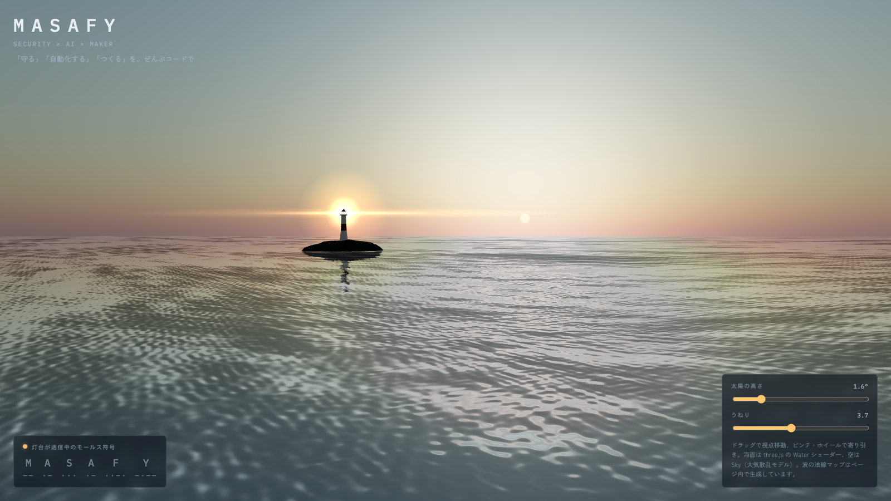

# 🌊 MASAFY Signal

> A lighthouse at dusk keeps signalling "MASAFY" in Morse code — a near-photoreal seascape built from three.js's Water shader and an atmospheric-scattering sky

A three.js piece that turns masafy.org's "protect" into a lighthouse and "all through code" into Morse code.
The whole thing is **one HTML file (~15 KB)** with **zero image files**. Even the wave normal map (**512×512**) is computed inside the page.
The lighthouse sends M-A-S-A-F-Y on a **~15-second loop**. Drag the sun below the horizon and the sea turns to night, with the light taking over the scene.

*[日本語](README.md)*

🔗 **[Live demo](https://masafykun.github.io/masafy-signal/)**

---

## 📸 Screenshot

Sun at 1.6°, the lighthouse flashing "M".



---

## ✨ Features

- **Waves without an image file** — three.js's Water expects a normal-map texture (`waternormals.jpg`). To run where external images can't load, the page builds one on a canvas from a **tileable height field of 64 summed sine waves**. Unless each wave vector is an integer, the edges don't meet and a grid of seams shows up across the sea.
- **Real Morse timing** — dot 1, dash 3, symbol gap 1, letter gap 3, word gap 9 (unit = 0.22 s). The lamp and the on-screen readout share one timeline. The light eases toward on/off instead of snapping, so it ramps up like a real lamp.
- **Sun height drives day and night** — every slider move re-bakes the sky into an environment map (PMREM), so the rock and tower pick up the sky's colour. The lamp grows at night and stays subtle by day.
- **The lighthouse reflects in the sea** — Water's mirror pass includes the tower and the glow sprites, so a streak of light falls across the surface.
- **Respects reduced motion** — with the OS "reduce motion" setting on, waves run at about 40 % speed.

---

## 🛠️ Tech stack

| Category | Technology |
|---|---|
| 3D | three.js r160 (Water / Sky / OrbitControls) |
| Rendering | WebGL, ACES Filmic tone mapping |
| Loading | import map (jsDelivr CDN), no build step |
| Fonts | IBM Plex Mono / Zen Kaku Gothic New (Google Fonts) |

---

## 📁 Directory layout

```
masafy-signal/
├── docs/
│   ├── index.html       # the piece itself (HTML, CSS and JS in one file); GitHub Pages source
│   └── screenshot.png   # screenshot for the README
├── README.md
├── README.en.md
└── LICENSE
```

---

## 🚀 Setup

```bash
# 1. Get it
git clone https://github.com/masafykun/masafy-signal.git
cd masafy-signal

# 2. Serve it locally
python3 -m http.server 8000
# → open http://localhost:8000/docs/ in a browser
```

Opening `index.html` straight from disk (`file://`) can leave a black screen, because some browsers won't load import-map ES modules that way. Use a local server. three.js and the fonts come from CDNs, so the first load needs a network connection.

---

## Controls

| Input | Action |
|---|---|
| Drag | orbit the view |
| Wheel / pinch | zoom in and out (60–700) |
| Sun height | −4° to 25°; below 0° it's night |
| Swell | strength of the surface distortion (0.5–8) |

---

## License

[](https://opensource.org/licenses/MIT)

- **Code** (`docs/index.html`): **MIT** — see [LICENSE](LICENSE).
- **three.js**: MIT (loaded from a CDN, not bundled here).
- **Fonts**: IBM Plex Mono and Zen Kaku Gothic New, both SIL Open Font License (loaded from Google Fonts).

© 2026 masafykun (https://github.com/masafykun)
