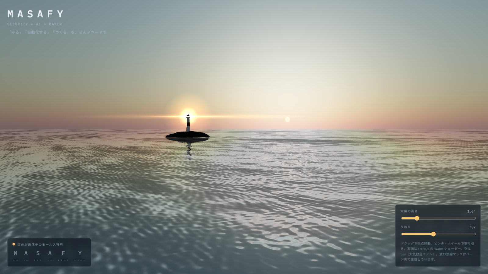

# 🌊 MASAFY Signal

> 夕暮れの海で、灯台が「MASAFY」をモールス信号で送り続ける — three.js の Water シェーダーと大気散乱の空で描くリアル寄りの海景

masafy.org の「守る」を灯台、「コードで」をモールス符号に置き換えた three.js 作品です。
画面は **HTML 1枚（約15KB）** だけで、画像ファイルは **0枚**。波の法線マップ（**512×512**）もページ内で計算して作っています。
灯台は M・A・S・A・F・Y を **1周 約15秒** で送り続け、太陽を沈めると夜の海になり、光が強く目立ちます。

*[English](README.en.md)*

🔗 **[デモを見る](https://masafykun.github.io/masafy-signal/)**

---

## 📸 スクリーンショット

太陽の高さ 1.6°、灯台が「M」を送っている瞬間。



---

## ✨ 特徴

- **画像ファイルなしで波を描く** — three.js の Water は波の凹凸を表す法線マップ画像（`waternormals.jpg`）を前提にしているが、外部画像を読めない環境でも動くよう、**64本の正弦波を重ねたタイル状の高さ場**から法線マップを canvas 上で生成した。波の向きを整数にしないと端がつながらず、海面に格子状の継ぎ目が出る。
- **モールス符号をそのまま光らせる** — 短点1・長点3・符号間1・文字間3・語間9（単位 0.22秒）のタイムラインを組み、灯台の光と画面下の表示を同期させている。光は 0/1 で切り替えず追従させて、実際の灯火らしい立ち上がりにした。
- **太陽の高さで昼夜が変わる** — スライダーを動かすたびに空を環境マップとして作り直し（PMREM）、灯台の岩や塔の照り返しも空の色に合わせる。夜ほど灯台の光を大きくし、日中は控えめにしている。
- **海面に灯台が映る** — Water の鏡面反射に灯台と光のスプライトが入るので、水面に光の筋が落ちる。
- **動きを減らす設定に対応** — OS の「視差効果を減らす」が有効なら、波の速さを約4割に落とす。

---

## 🛠️ 技術スタック

| カテゴリ | 技術 |
|---|---|
| 3D | three.js r160（Water / Sky / OrbitControls） |
| 描画 | WebGL、ACES Filmic トーンマッピング |
| 読み込み | import map（jsDelivr CDN）、ビルド工程なし |
| フォント | IBM Plex Mono / Zen Kaku Gothic New（Google Fonts） |

---

## 📁 ディレクトリ構成

```
masafy-signal/
├── docs/
│   ├── index.html       # 作品本体（HTML・CSS・JS を1ファイルに収めた）。GitHub Pages の公開元
│   └── screenshot.png   # README 用のスクリーンショット
├── README.md
├── README.en.md
└── LICENSE
```

---

## 🚀 セットアップ

```bash
# 1. 取得する
git clone https://github.com/masafykun/masafy-signal.git
cd masafy-signal

# 2. ローカルサーバーで開く
python3 -m http.server 8000
# → http://localhost:8000/docs/ をブラウザで開く
```

`index.html` をダブルクリックして `file://` で開くと、ブラウザによっては import map の ES モジュールが読み込めず真っ黒になる。ローカルサーバー経由で開くこと。three.js とフォントは CDN から読むので、初回はネット接続が必要。

---

## 操作

| 入力 | 動作 |
|---|---|
| ドラッグ | 視点を回す |
| ホイール / ピンチ | 寄る・引く（60〜700） |
| 太陽の高さ | −4°〜25°。0°より下で夜になる |
| うねり | 海面のゆがみの強さ（0.5〜8） |

---

## ライセンス

[](https://opensource.org/licenses/MIT)

- **コード**（`docs/index.html`）: **MIT** — [LICENSE](LICENSE) 参照。
- **three.js**: MIT（CDN から読み込み、このリポジトリには同梱していない）。
- **フォント**: IBM Plex Mono / Zen Kaku Gothic New ともに SIL Open Font License（Google Fonts から読み込み）。

© 2026 masafykun (https://github.com/masafykun)
